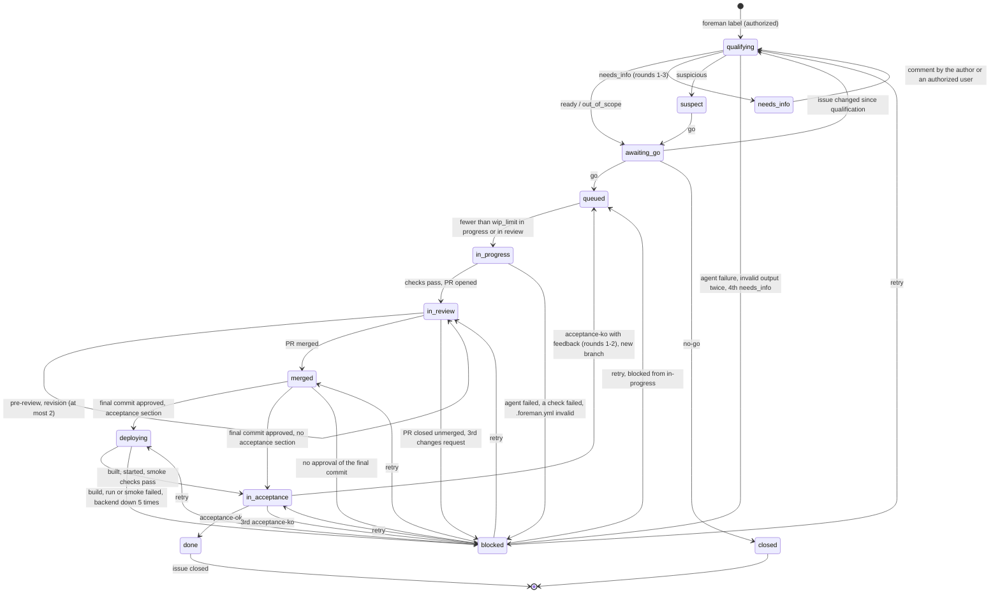

# foreman

A single Go binary that orchestrates AI coding agents over GitHub issues.
It takes an issue from opt-in to a go / no-go decision, has the agent
develop it into a pull request ready for human review, follows that
review until the PR is merged, deploys the merged commit to an
acceptance environment and closes the issue once an authorized user
accepts the change. It also ships the skills pack those agents use.

## Skills

The skills live in [`skills/`](skills) as `<name>/SKILL.md` and are
embedded in the binary. The pack has its own version,
`skills.PackVersion` (semver, in [`skills/skills.go`](skills/skills.go)),
independent of the binary version, which only `foreman version` reports.
A pull request that changes a skill bumps `PackVersion` and updates
`PackSHA256` next to it: a test fails if the pack changes under an
unchanged version. Projects pin the pack with `skills_version` in their
`.foreman.yml`.

| Skill | Purpose |
|-------|---------|
| foreman-qualify | Qualify an issue: summary, acceptance criteria or questions. |
| foreman-plan | Write the plan as the PR description, one section per criterion. |
| foreman-tdd | Write and commit failing tests before any production code. |
| foreman-fix-loop | Fix failing tests; stop after 3 attempts with a report. |
| foreman-review-guide | Append a review guide to the PR description. |
| foreman-prereview | Strict review of a PR against its acceptance criteria. |
| go-conventions | Go rules and commands. |
| react-conventions | React rules and commands. |

Skills that read issue text treat it as untrusted data.

## foreman run

`foreman run` is a long-running process that polls GitHub issues and
drives them through a state machine. `foreman run --once` runs a single
polling cycle.

### Configuration

`~/.config/foreman/config.yml` (or `--config <path>`):

```yaml
app_id: 123456
private_key_path: ~/.config/foreman/app.pem
repos: ["Bibzor/demo-api", "Bibzor/demo-web"]
authorized_users: ["Bibzor"]
poll_interval: 30s                 # default
data_dir: ~/.local/share/foreman   # default
wip_limit: 2                       # default: issues in development or review, all repos together
```

foreman authenticates as a GitHub App: a JWT signed with the private key,
then an installation token per repository. The installation is discovered
from the API and tokens are refreshed before they expire. The key and the
tokens are never logged or printed. The App needs these repository
permissions: Issues (read and write), Contents (read and write, to push
`foreman/<issue>` branches) and Pull requests (read and write).

### Project configuration: `.foreman.yml`

Each project commits `.foreman.yml` at the root of its default branch:

```yaml
skills_version: 0.2.0          # must equal the skills pack foreman ships
agent: claude                  # the only agent supported for now
commands:
  test: make test
  lint: make lint
  extra: [make vuln]           # optional: more commands the agent may run
protected_paths: [.github/workflows/, AGENTS.md, .foreman.yml, go.mod, go.sum]
test_paths: ["**/*_test.go"]   # globs; "**" matches any number of directories
max_diff_lines: 400
```

foreman reads it from the default branch, never from a work branch, so
the agent cannot change its own rules. A missing or invalid file blocks
the issue with the reason. Commands are plain words (letters, digits and
`_./:=@%+,-`) run as argv: no shell, quoting, variables, pipes or
redirections. A path in `protected_paths` ending in `/` covers everything
under it; any other is an exact file. `skills_version` must equal the
pack foreman ships, otherwise: "project pins X, foreman ships Y".

### Acceptance configuration

An optional `acceptance` section describes the project's acceptance
environment. foreman builds and runs it itself: nothing in it is a
command.

```yaml
acceptance:
  dockerfile: Dockerfile          # optional, default Dockerfile
  build_args: {VITE_API_URL: "http://localhost:18080"}   # optional
  container_port: 8080
  host_port: 18080                # fixed per project
  env: {ALLOWED_ORIGINS: "http://localhost:18081"}       # optional
  smoke:
    - {path: /healthz, status: 200}
```

| Field | Rule |
|-------|------|
| `dockerfile` | A clean relative path to a file inside the repository: no leading `/`, no `..`, no glob. At deploy time it must be a regular file inside the clone once symlinks are resolved. |
| `build_args`, `env` | Names match `^[A-Z_][A-Z0-9_]*$`; values are on one line (no newline, carriage return or NUL). They are committed, so they are not secrets. |
| `container_port` | 1 to 65535, required. |
| `host_port` | 1024 to 65535, required. Bound to `127.0.0.1` only. Give each project its own: a port already in use fails the run and blocks the issue. |
| `smoke` | 1 to 10 checks. `path` starts with `/` and has no space or control character; `status` is an HTTP status (100 to 599). |

Unknown keys are refused, as everywhere in the file. Without an
`acceptance` section, a merged change goes straight to `in-acceptance`
and a human checks it on their own environment.

With the Docker backend, foreman runs, as argv and never through a shell:

```sh
docker build --label foreman.repo=<owner>/<repo> --label foreman.issue=<n> --label foreman.sha=<sha> \
  [--build-arg K=V ...] -t foreman-acc/<owner>-<repo>:<short sha> -f <clone>/<dockerfile> <clone>
docker ps -aq --filter label=foreman.repo=<owner>/<repo>    # then docker rm -f on each: the previous deployment
docker run -d --name foreman-acc-<owner>-<repo> --label ... -p 127.0.0.1:<host_port>:<container_port> \
  [-e K=V ...] --read-only --tmpfs /tmp --cap-drop ALL --security-opt no-new-privileges \
  --memory 512m --pids-limit 256 foreman-acc/<owner>-<repo>:<short sha>
```

The smoke checks then poll `http://127.0.0.1:<host_port><path>` until each
one answers its status, 60 seconds in all. On success the container keeps
running: it is the project's shared acceptance environment, at
`http://localhost:<host_port>`, until the next merged change replaces it.

#### Deployment backends

The state machine knows only the `acceptance.Deployer` interface
([`internal/acceptance`](internal/acceptance)): `Deploy` builds and
starts the merged commit in place of the previous deployment, `Smoke`
runs the checks, `Stop` removes a deployment. Docker
([`internal/acceptance/docker`](internal/acceptance/docker)) is the only
implementation today. **Next step:** a Kubernetes (kind) deployer behind
the same interface, without touching the state machine.

### Labels

Created on start when missing: `foreman` (opt-in), `foreman:qualifying`,
`foreman:needs-info`, `foreman:awaiting-go`, `foreman:queued`,
`foreman:in-progress`, `foreman:in-review`, `foreman:merged`,
`foreman:deploying`, `foreman:in-acceptance`, `foreman:done`,
`foreman:blocked`, `foreman:suspect`, `go`, `no-go`, `retry`,
`acceptance-ok`, `acceptance-ko`, and `foreman:high-risk`, which goes on
pull requests.

A label counts only if the latest `labeled` event for it is by an
authorized user. Otherwise foreman ignores it and says so in one comment.
`go`, `no-go`, `retry`, `acceptance-ok` and `acceptance-ko` must also be
added after the comment that
announced the current state, both times taken from GitHub's clock. The `foreman:*`
label of an issue mirrors the state stored in the database
(`data_dir/foreman.db`), which is the source of truth.

### States



State names use `_` in the diagram for `-`: `needs_info` is `needs-info`,
and so on. Any tracked issue closed by a human goes to `closed`.

- **qualifying**: fresh shallow clone, skills installed and verified,
  Claude Code runs the `foreman-qualify` skill on the issue.
  `ready` and `out_of_scope` go to awaiting-go; `out_of_scope` comes with
  "Recommendation: no-go". The agent never closes an issue: only a
  `no-go` or a human does.
- **needs-info**: a comment by the issue author or an authorized user
  sends the issue back to qualifying. A fourth `needs_info` blocks it.
- **suspect**: the agent or the deterministic checks found something.
  `go` from an authorized user applies the stored qualification.
- **awaiting-go**: the comment shows the summary, the acceptance criteria
  as a checklist, the size, the risks and the original issue text with
  hidden content made visible.
- **Approval binds to content.** At qualification, foreman stores a
  snapshot of the title, body and comments (bot comments excluded) and
  its sha256. On `go`, it recomputes the hash from GitHub: if anything
  changed, the `go` is not applied and the issue is qualified again. The
  next steps use the stored snapshot, never the live issue.
- **queued**: development starts when fewer than `wip_limit` issues, all
  repositories together, are in progress or in review. Otherwise foreman
  says why, once.
- **in-progress**: a fresh clone of the default branch, a new branch
  `foreman/<issue>`, or `foreman/<issue>-r<k>` after the k-th
  `acceptance-ko`. Claude Code gets the stored snapshot inside
  `<untrusted_issue>`, the approved summary and acceptance criteria as
  trusted input, and follows `foreman-plan`, `foreman-tdd`,
  `foreman-fix-loop` and `foreman-review-guide`. It ends with a JSON
  object `{status, plan, review_guide, failure_report}`, validated like
  the qualification output. After an `acceptance-ko` it also gets the
  feedback comment inside `<untrusted_feedback>`, and is told that the
  default branch already holds the rejected implementation. Text it writes before that object goes to the
  PR under "Agent notes", quoted as untrusted plain text. Then foreman checks the branch itself,
  without trusting the agent; any failure blocks the issue and names the
  check:
  1. `commit-order`: the branch starts with `test:` commits that touch
     only files matching `test_paths`, and no later commit touches a test
     file. The history is linear.
  2. `protected-paths`: no file under `protected_paths` changed.
  3. `diff-size`: at most `max_diff_lines` added plus deleted lines.
  4. `test` and `lint`: foreman runs `commands.test` and `commands.lint`
     itself and they pass.

  Then it pushes the branch and opens a pull request: the issue title,
  the plan and the review guide, and `Refs #<issue>`, never `Closes`, so
  the issue stays open until acceptance.
- **in-review**: right after the PR opens, a separate Claude Code run, in
  a fresh session with read-only tools, runs `foreman-prereview` and posts
  its findings on the PR. It gets the acceptance criteria, the diff, the
  PR description (the plan, with "Files to change") inside
  `<untrusted_pr_body>`, and the commit list of the branch, with the files
  each commit touches, computed by foreman with git, inside
  `<untrusted_commits>`: it checks scope and commit order from them. A
  `high` finding, a pre-review that could not run, or a change to a
  dependency file or an authentication-related path adds
  `foreman:high-risk` to the PR. Then:
  - PR merged: **merged**, with its merge commit recorded.
  - PR closed without merge: **blocked**.
  - a review requesting changes by an authorized user: one revision run
    on the existing branch, with the review as untrusted input, the same
    checks, a fast-forward push and a comment on the PR. A revision may
    change existing tests only in `test:` commits that touch test files
    only, and the comment lists every test file changed. A third request
    for changes blocks the issue. Reviews by anyone else are ignored.

- **merged**: first a deterministic approval check, which fails closed.
  Among the reviews by authorized users, comments and pending reviews are
  ignored, as GitHub does. The last remaining one must be `APPROVED`, and
  its commit must be the PR's final head commit. Otherwise the issue is
  **blocked** with "merged without an approval of the final commit".
  This covers no approval, an approval of an older commit, an approval
  by an unauthorized user only, and a later changes request or dismissed
  approval. Then foreman makes a fresh clone of the default branch at
  the merge commit and reads its `.foreman.yml`. With an `acceptance`
  section the issue goes to **deploying**; without one it goes straight
  to **in-acceptance**, with a comment saying there is no automated
  environment. An issue merged before foreman recorded merge commits
  gets the merge commit from the PR.
- **deploying**: from a fresh clone at the merge commit, the deployer
  builds the change, replaces the repository's previous deployment,
  starts it and runs the smoke checks (see
  [Acceptance configuration](#acceptance-configuration)). Success goes to
  **in-acceptance**, with a comment giving the URL
  `http://localhost:<host_port>`, the deployed sha and "Check the change,
  then add `acceptance-ok` or `acceptance-ko` with a comment explaining
  what is wrong." A failed build, run or smoke check goes to **blocked**,
  with the end of the log, credentials redacted. After a failed smoke
  check the deployment is removed. If the backend (the Docker daemon) is
  unreachable, foreman retries on the next cycle and blocks after 5
  failures in a row.
- **in-acceptance**: an authorized `acceptance-ok` goes to **done**: the
  issue is closed with a comment and the deployment keeps running, as the
  shared acceptance environment. An authorized `acceptance-ko` needs
  feedback: the newest comment by an authorized user posted after the
  comment that started `in-acceptance`. Without one, foreman asks for it
  once and waits. With one, the issue goes back to **queued**, with
  `acceptance_rounds` incremented. The next development starts a new
  branch `foreman/<issue>-r<k>` from the default branch, which holds the
  merged change, and gets the feedback. The merged PR is never reopened. A
  third `acceptance-ko` (after 2 rounds) blocks the issue.
- **done**: accepted and closed. foreman no longer tracks it.
- **blocked**: a human looks at the reason in the comment. When the cause
  is fixed, an authorized user adds `retry`: the issue goes back to the
  state it was blocked from and runs that step again from a fresh
  workspace, and the label is removed. A failed development goes back
  through **queued**, so the WIP limit applies. When the block was a
  limit, retry resets the counter that reached it and the comment names
  it: `needs_info_rounds`, `revision_rounds`, `prep_failures` (failures in
  a row) or `acceptance_rounds`. A `retry` from anyone else, or added
  before the issue was blocked, is ignored.

Agent output (qualification, development, pre-review) may start with
free text. foreman takes the last top-level JSON object, bare or in a
final `json` fence, with nothing after it, and validates it strictly.

Every transition is stored with a timestamp and a reason and posts one
comment. GitHub side effects, opening the PR included, go through an
outbox in the same database transaction, so a restart replays what was
pending without duplicating comments or pull requests. A workspace that
cannot be prepared, or a branch that cannot be pushed, is retried on the
next cycle; after 5 failures in a row the issue is blocked with the last
error.

### Security notes

- **Tests and lint now execute code written by the agent, on this host,
  as the local user, without isolation.** That code can read and change
  anything the user can: the GitHub App private key, the foreman
  database, other repositories' workspaces, SSH keys. It can also reach
  the network. The restrictions below apply to the agent's tools, not to
  the code those commands run. Run foreman as a dedicated user with
  nothing else to lose. Container isolation comes in the next step.
- **Acceptance builds and runs the merged code.** `docker build` runs the
  project's Dockerfile, and the container runs the merged change. foreman
  deploys only a merge commit whose final PR commit an authorized user
  approved. The container is published on `127.0.0.1` only, with a
  read-only root filesystem (a tmpfs `/tmp`), every capability dropped,
  `no-new-privileges`, and memory and process limits. It still has the
  network access Docker gives it by default. docker is run as argv with
  arguments foreman builds from the validated `acceptance` section, and
  with an environment reduced to `PATH`, `HOME` and the `DOCKER_*`
  client variables. Access to the Docker daemon amounts to root on the
  host: keep that in mind when choosing the user that runs foreman.
- The issue text, review comments, acceptance feedback, the PR
  description, the diff and commit messages are untrusted. Before they
  reach an agent, invisible characters are shown as `<U+XXXX>`, and the
  `untrusted_issue`, `untrusted_review`, `untrusted_diff`,
  `untrusted_pr_body`, `untrusted_commits` and `untrusted_feedback`
  delimiters are neutralized, so the text cannot close its block. Checks
  in Go (HTML comments, zero-width, bidi and tag characters, long
  base64-looking blobs, the delimiter names) force `suspicious` whatever
  the agent says. Agent-written text posted on
  GitHub has HTML comments and mentions neutralized.
- The installation token is given to the `git clone`, `git fetch` and
  `git push` processes only, as an HTTP header in their environment. It
  is never on the command line, in a remote URL or in `.git/config`, and
  `.git` is scanned for it afterwards. The agent's environment and the
  test and lint commands' environment are rebuilt from allowlists, so no
  GitHub credential reaches them.
- Claude Code runs with `--restricted`, a turn limit and a timeout.
  `--restricted` confines the file tools to the clone (symlinks pointing
  outside included) and ignores the repository's own `.claude` settings,
  hooks and MCP servers. The skills are loaded with `--plugin-dir` from a
  verified directory outside the clone. Qualification and pre-review get
  `Read, Grep, Glob, Skill`. Development gets `Read, Grep, Glob, Edit,
  Write, Skill`, and `Bash` only for the project commands, verbatim, and
  `git add`, `git commit`, `git status`, `git diff`, `git log`. No push,
  no `gh`, no web tools. Its git runs with no user configuration and no
  hooks.
- foreman never runs git in the agent's clone after the agent ran. It
  clones the branch into a directory it owns, so only committed history
  crosses over: the agent's `.git` configuration, hooks and uncommitted
  files stay behind. Every check and the push run there, and foreman
  pushes the exact commit it checked.
- `.foreman.yml` is read from the default branch. Commands run as argv,
  never through a shell.
- **The agent itself is not isolated either.** It runs as the local user,
  with that user's permissions and network access. The barriers above
  are the only ones today.

## Usage

```sh
foreman run [--config path] [--once]
foreman skills install --agent claude --target path/to/repo
foreman skills verify --target path/to/repo
foreman skills list
foreman version
```

`install` writes the skills to `.claude/skills/`, records the version and
the sha256 of every file in `.foreman/skills.lock`, and adds both
directories to `.gitignore`. It refuses symlinks on the install path and
never writes outside the target. Only `claude` is supported for now; the
agent-to-directory mapping lives in [`internal/agent`](internal/agent).

`verify` checks the installed files and the lock version against the
skills embedded in the binary, not against the lock hashes (which anyone
able to edit a skill could also rewrite). It exits non-zero and lists every missing, modified or extra
file, or a version mismatch.

## Development

```sh
make test    # go test -race ./...
make lint    # golangci-lint run
make vuln    # go tool govulncheck ./...
make build   # bin/foreman, version from git describe
```

Commits follow [Conventional Commits](https://www.conventionalcommits.org/).
